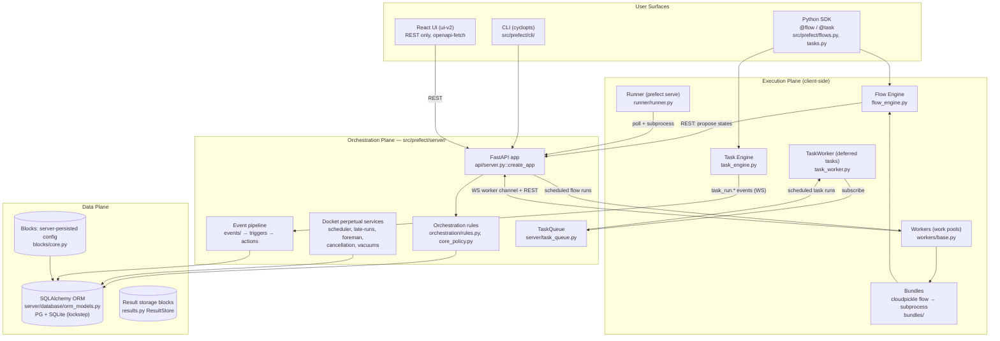
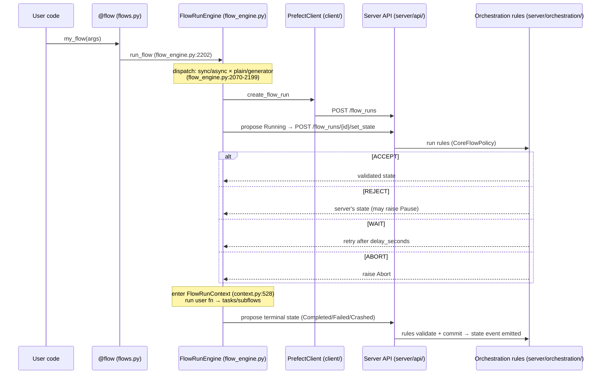
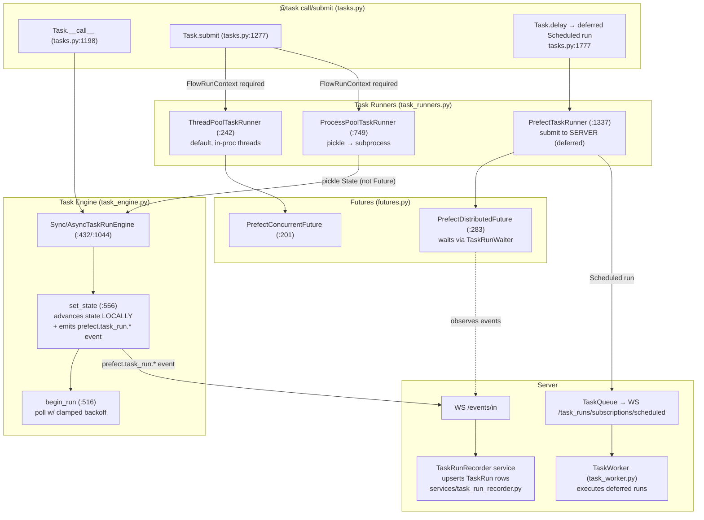
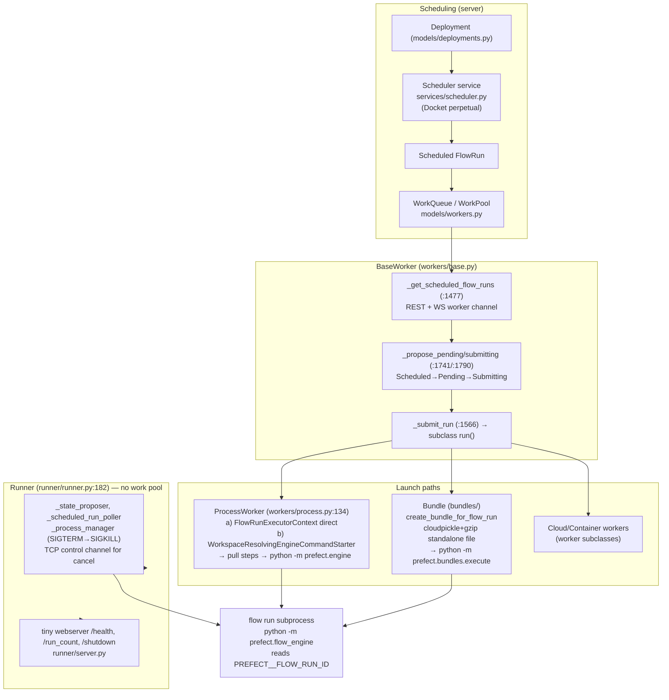
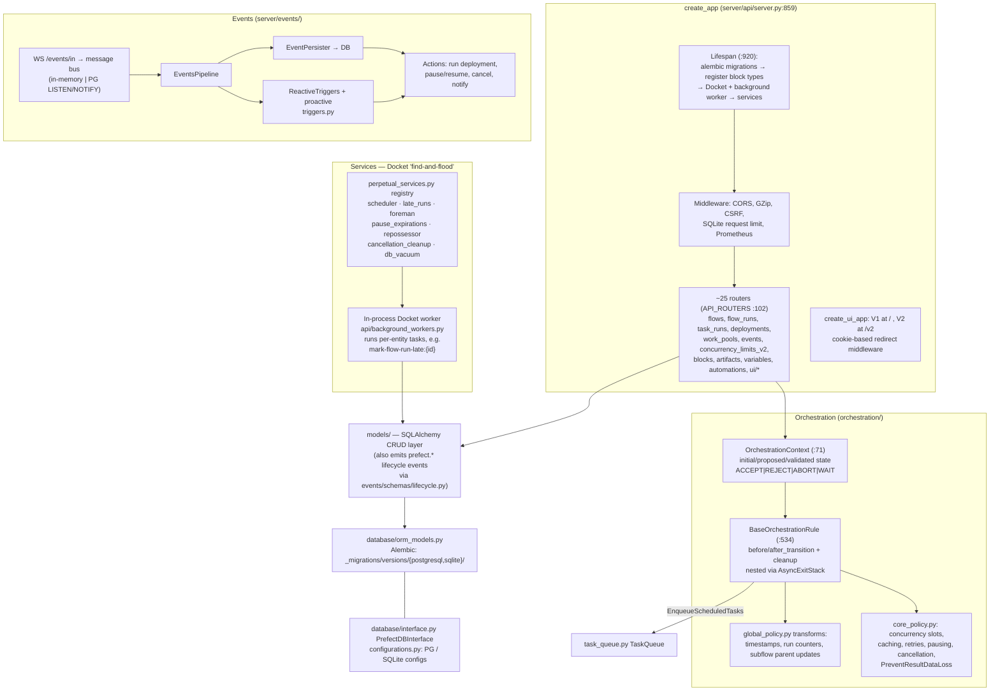
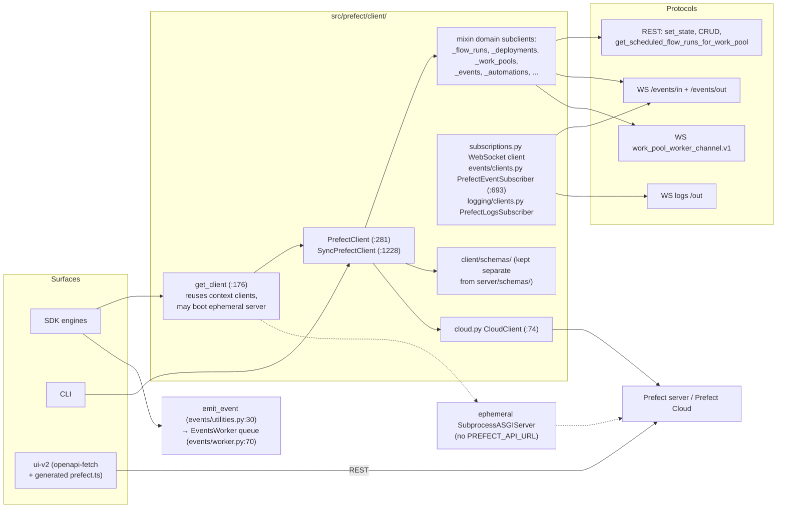
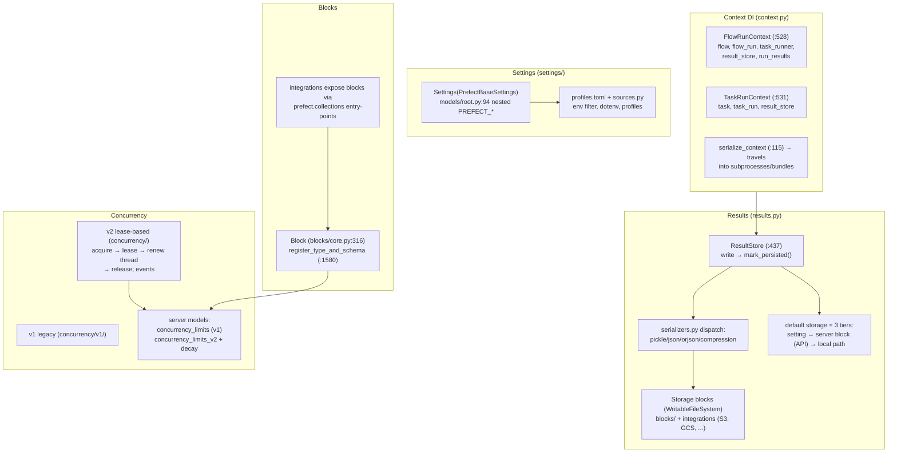

# Prefect Architecture Reference (2026-10-14)

Diagrams + file references for the systems architecture. Each section is self-contained; use the reference index at the bottom to retrieve details without re-reading the whole doc.

---

## 1. High-Level System Diagram

**The core architectural split:** flow-run states are *proposed to the server* (rules ACCEPT/REJECT/WAIT/ABORT); task-run states are *advanced locally* by the task engine and only *reported* via `prefect.task_run.*` events, which `TaskRunRecorder` upserts into the DB. See `src/prefect/AGENTS.md:28-29`.

---

## 2. Flow Execution — Lifecycle Sequence

- State proposal logic: `src/prefect/utilities/engine/__init__.py:514` (sync), `:612` (async).
- Endpoint: `src/prefect/server/api/flow_runs.py:820`.
- Rules: `BaseOrchestrationRule` = async context manager per rule, nested via AsyncExitStack around the DB commit — `src/prefect/server/orchestration/rules.py:534`.
- Policies: `CoreFlowPolicy` / `CoreTaskPolicy` / `MinimalFlowPolicy` (`force=True` still guarded) — `server/orchestration/core_policy.py`.
- Subprocess entrypoint: `python -m prefect.flow_engine <entrypoint>` reads `PREFECT__FLOW_RUN_ID` (`flow_engine.py:281`).
- Subflows: synthetic tracking task + `parent_task_run_id` (`flow_engine.py:981`, `:922`).

---

## 3. Task Execution — Local State Advancement

Key contrasts vs flow engine (from `src/prefect/AGENTS.md`):
- `Task.create_run` (tasks.py:876) makes the **only** server call (`client.create_task_run`); all later transitions are local.
- `ProcessPoolTaskRunner` requires picklable data — futures must be resolved to `State` in the parent (`resolve_to_final_result`).
- `PrefectTaskRunner`/`Task.delay()` = server-side execution; the `TaskWorker` reads deferred parameters from result storage (`task_worker.py:633`).

---

## 4. Remote Execution — Workers, Runner, Bundles

- Worker↔server WebSocket: `/work_pools/{name}/workers/connect` (`server/api/workers.py:1088`), protocol schema `client/schemas/worker_channel.py`.
- Server→worker teardown messaging: pluggable `server/worker_communication/cleanup_queue/` (in-memory default; `PREFECT_SERVER_WORKER_CHANNEL_CLEANUP_QUEUE_STORAGE` for Redis/HA).
- `infrastructure/` is now only **provisioners** (ECS, Cloud Run, etc.); old Agent/Infrastructure classes were removed in Prefect 3 (`infrastructure/agent.py` = 9-line shim).

---

## 5. Server Internals — Request & Service Flow

Adding an endpoint = the layering order **schema → model → route** (`server/AGENTS.md:15-23`); `variables` is the canonical example.

---

## 6. Client Architecture & Data Interfaces

- **`prefect-client` package build** (repo-root `client/`): `build_client.sh` copies `src/prefect/`, strips `cli/`, `server/` (except `server/api/`), etc. Dep changes must mirror `pyproject.toml` ↔ `client/pyproject.toml`.

---

## 7. Cross-Cutting Concerns

---

## 8. Reference Index

| Topic | Where |
|---|---|
| Server invariant contracts | `src/prefect/server/AGENTS.md` |
| SDK invariant contracts (engines, results, suspension) | `src/prefect/AGENTS.md` |
| Worker/runner/deployment contracts | `src/prefect/workers/AGENTS.md`, `runner/AGENTS.md`, `deployments/AGENTS.md` |
| State proposal (sync/async) | `src/prefect/utilities/engine/__init__.py:514,612` |
| set_state endpoint | `src/prefect/server/api/flow_runs.py:820` |
| Orchestration context/rules/transforms | `server/orchestration/rules.py:71,534,969` |
| Policy rule set | `server/orchestration/core_policy.py` |
| Worker polling → dispatch → submit | `workers/base.py:1477,1506,1566,1741,1790` |
| Perpetual services registry | `server/services/perpetual_services.py`, `server/api/background_workers.py` |
| TaskRunRecorder (event→DB upsert) | `server/services/task_run_recorder.py` |
| Event ingestion websockets | `server/api/events.py` |
| Worker WebSocket channel | `server/api/workers.py:1088`, `client/schemas/worker_channel.py` |
| Client composition | `client/orchestration/__init__.py:281,1228`, subclients in `client/orchestration/*/client.py` |
| Event emission / subscriber | `events/utilities.py:30`, `events/clients.py:275,693`, `events/worker.py:70` |
| ResultStore / default tiers | `results.py:437,163` |
| Contexts | `context.py:528,531,115` |
| Settings model / profiles | `settings/models/root.py:94`, `settings/profiles.py:182` |
| Blocks registration | `blocks/core.py:316,1580` |
| Concurrency v2 leases | `concurrency/_leases.py`, `concurrency/services.py` |
| DB interface / migrations | `server/database/interface.py`, `server/database/_migrations/versions/` |
| UI API layer | `ui-v2/src/api/service.ts`, generated `ui-v2/src/api/prefect.ts` |
| prefect-client build | `client/build_client.sh`, `client/pyproject.toml` |
| Deployments (prefect.yaml, steps) | `deployments/base.py`, `deployments/steps/{core,pull,utility}.py`, `deployments/runner.py:167` |
| Bundles | `bundles/__init__.py`, `bundles/execute.py` |
| Tests map | `tests/` mirrors src; e2e `integration-tests/`; cloud compat `compat-tests/` (submodule); UI `ui-v2/tests/`, `ui-v2/e2e/` |

## 9. Rules of Thumb (from AGENTS.md contracts)

1. **Flow states → server; task states → local + events.** Never bypass server orchestration for flow runs.
2. **Sync/async engine paths must stay in lockstep** — mirror every behavior change.
3. **SQLite and PostgreSQL migrations must stay in lockstep** — CI tests both.
4. **`force=True` routes through `MinimalFlowPolicy`** — not a true bypass (still `PreventResultDataLoss`).
5. **Perpetual services use `Perpetual(automatic=True)`** and Docket keys `"<service>:<entity-id>"` to prevent duplicate enqueues.
6. **Every result write must call `mark_persisted()`** or state metadata is silently dropped.
7. **Server vs client schemas stay separate** (`server/schemas/` vs `client/schemas/`).
8. **Auth token comparisons use `hmac.compare_digest`** (CSRF, basic auth, WS auth).
