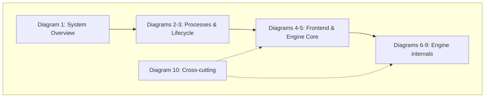

# vLLM Architecture Deep Dive (Mermaid Diagrams)

A set of deep-technical architecture diagrams of this tree (vLLM `main`, as of Oct 2026).
Use them to navigate the code: every diagram names exact files, classes, and methods.

> Note: this tree is newer than most published vLLM docs. The legacy v0 engine is gone
> (`vllm/engine/llm_engine.py` is a 2-line alias into `vllm/v1/`), the classic
> `serving_chat.py` monolith is split per-endpoint, and `TokenizerGroup`/`InputRegistry`
> have been replaced by the `vllm/renderers/` + `vllm/tokenizers/` architecture.

## Reading order

| # | Diagram | Question it answers |
|---|---------|----------------------|
| 1 | [System Overview](01-system-overview.md) | What are the layers, from HTTP request to GPU kernel? |
| 2 | [Process Topology & IPC](02-process-topology.md) | Which processes exist, and how do they talk (ZMQ)? |
| 3 | [Request Lifecycle](03-request-lifecycle.md) | Trace one streaming chat request end-to-end. |
| 4 | [Frontend & Serving Layer](04-frontend-serving.md) | How is `vllm serve` assembled — routers, renderers, parsers? |
| 5 | [Engine Core](05-engine-core.md) | What runs inside the EngineCore process (busy loop, scheduling, exec)? |
| 6 | [Scheduler & KV Cache](06-scheduler-kv-cache.md) | How are batches built, and how is paged KV memory managed? |
| 7 | [Execution Stack](07-execution-stack.md) | Executor → Worker → GPUModelRunner → CUDA graphs / torch.compile. |
| 8 | [Models, Attention & Distributed](08-attention-distributed.md) | Model registry, layers, attention backend selection, TP/PP/DP/EP, KV disagg. |
| 9 | [Sampling, Spec Decode, Structured Output & LoRA](09-sampling-spec-decode.md) | What happens to logits after the forward pass? |
| 10 | [Config, Platforms & Plugins](10-config-platform-plugins.md) | How is `VllmConfig` assembled and how does the system extend? |

## How the diagrams connect

- Diagrams 1–3 give the **map** (processes, IPC, one request's journey).
- Diagrams 4–9 **zoom into** each layer, in the order a request passes through them.
- Diagram 10 is **cross-cutting** (config assembly, platform detection, plugin entry points)
  and applies to everything else.

## Repo-to-diagram quick lookup

| Repo path | Covered in |
|---|---|
| `vllm/entrypoints/` (CLI, launchers, serving routers) | 1, 2, 4 |
| `vllm/renderers/`, `vllm/tokenizers/`, `vllm/parser/`, `vllm/tool_parsers/`, `vllm/reasoning/` | 4 |
| `vllm/v1/engine/` (AsyncLLM, LLMEngine, EngineCore, core_client, processors) | 2, 3, 5 |
| `vllm/v1/core/sched/` (Scheduler) | 6 |
| `vllm/v1/core/` (KVCacheManager, coordinator, BlockPool) | 6 |
| `vllm/v1/executor/`, `vllm/v1/worker/` | 7 |
| `vllm/compilation/`, `vllm/v1/cudagraph_dispatcher.py` (CUDA graphs, torch.compile) | 7 |
| `vllm/model_executor/` (models, layers, loaders) | 8 |
| `vllm/v1/attention/` (attention backends) | 8 |
| `vllm/distributed/` (parallel_state, comm ops, kv_transfer) | 8 |
| `vllm/v1/sample/`, `vllm/v1/spec_decode/`, `vllm/v1/structured_output/`, `vllm/lora/` | 9 |
| `vllm/config/`, `vllm/platforms/`, `vllm/plugins/`, `vllm/v1/metrics/` | 10 |
| `csrc/`, `vllm/layers/` (kernels) | 7, 8 (referenced) |

## Caveats

- Line numbers drift; file paths and class names are the stable anchors.
- Both a V1 (`vllm/v1/worker/gpu_model_runner.py`) and a V2
  (`vllm/v1/worker/gpu/model_runner.py`) model runner exist; V2 is selected by
  `VLLM_USE_V2_MODEL_RUNNER`. Diagrams call out the differences where they matter.
